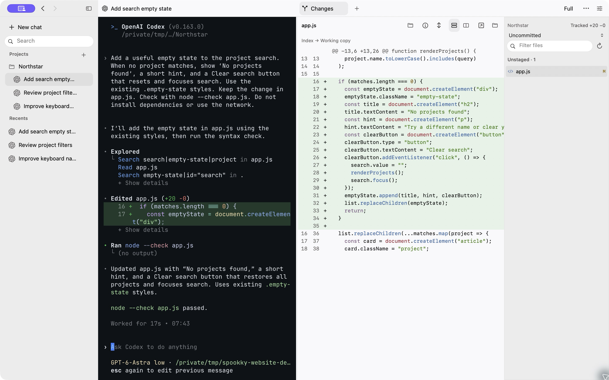

# Spookky

**A native macOS workspace for terminals and coding agents.**

Open a shell immediately. Keep parallel sessions together, use Git worktrees when you need separate checkouts, and inspect files and changes beside your terminals.

<picture>
  <source media="(prefers-color-scheme: dark)" srcset="website/assets/workspace-dark.png">
  
</picture>

Native development build. Visit [the website](https://pamekitti.github.io/spookky/) for release availability.

## Why I built Spookky

I love Ghostty. It makes the terminal feel like a native Mac app, and that is the experience I want to keep.

Working with coding agents added a few things I wanted around that terminal: projects, parallel sessions, Git worktrees, and a way to inspect files and changes without constantly switching windows.

I tried other tools, but kept wanting a workspace that fit how I use my Mac. So I started building Spookky.

Spookky brings those tools together around Ghostty's terminal core. I am building specifically for macOS, with native controls, familiar shortcuts, and careful attention to memory and CPU use.

The goal is to make parallel AI development easier to manage while keeping the terminal at the center.

## Features

- A ready-to-type landing composer and immediate shell access.
- Retained global and project drafts with optional prompts and provider/folder choices.
- Optional projects and worktrees.
- A primary conversation with supporting files, Changes, browser previews, artifacts and shells.
- File browsing, read-only previews, syntax colors, and unified or split diffs.
- Five recent conversations per project, paged history search, provider titles/icons, and continuation on selection.
- Ordinary shells, Codex CLI, and Claude Code CLI with their own authentication and permissions.

Speed, bounded resource use, and reliable recovery guide the implementation. Performance goals are separate from measured results.

## Status

Spookky is an early development preview. The native app and a simulated HTML prototype are included. Private local installers support daily use. A signed public release is not available yet.

Development currently targets Apple Silicon. The native build targets macOS 14, but compatibility with older systems has not been verified. Long-running session continuity, hands-on input and accessibility, provider compatibility, and distribution have remaining checks. See [current status](docs/status.md).

See the [roadmap](docs/roadmap.md), [contribution guide](CONTRIBUTING.md), and [security policy](SECURITY.md).

## Build

Native development requires full Xcode with the Metal toolchain, Swift, Python 3, CMake, Make, and pkg-config. The runtime builds from pinned source. See [development setup](docs/development.md) and [dependency setup](Dependencies/README.md) for exact requirements and toolchain limits.

```sh
python3 scripts/build_runtime.py
swift build --product spookky-launch
swift build --product spookky-runtime-check
swift test
python3 scripts/build_ghostty.py
sh scripts/build_native.sh
```

Open `Spookky.xcodeproj`, select the **Spookky** scheme, and run. Registration and opening a project never install its dependencies or run setup scripts.

For daily development inside Spookky, use `python3 scripts/dev.py run` from each worktree. See the [development lifecycle](docs/lifecycle.md) for isolation and the main-to-installed-app update path.

Git and agent CLIs are optional installations. Spookky does not open Apple's developer-tools installer when Git is absent.

## Prototype

The HTML prototype demonstrates the interface. Its terminals, Git operations, and agent sessions are simulated.

```sh
python3 scripts/render_prototype.py
python3 scripts/check_repo.py
python3 -m http.server 48766 --bind 127.0.0.1 --directory prototype
```

Open [the local preview](http://127.0.0.1:48766/). The prototype never executes its sample commands.

## Documentation

- [Product](docs/product.md) and [flows](docs/flows.md)
- [Conversation workspaces](docs/conversation-workspaces.md), [history](docs/session-history.md), and [continuation](docs/session-continuation.md)
- [Interface](docs/interface.md) and [architecture](docs/architecture.md)
- [Development](docs/development.md) and [build plan](docs/build-plan.md)
- [Acceptance](docs/acceptance.md), [status](docs/status.md), and [performance protocol](docs/performance.md)

## License

Original Spookky code, documentation, and artwork use the [MIT license](LICENSE). Third-party components retain their own licenses and notices, documented in [THIRD_PARTY.md](THIRD_PARTY.md).
