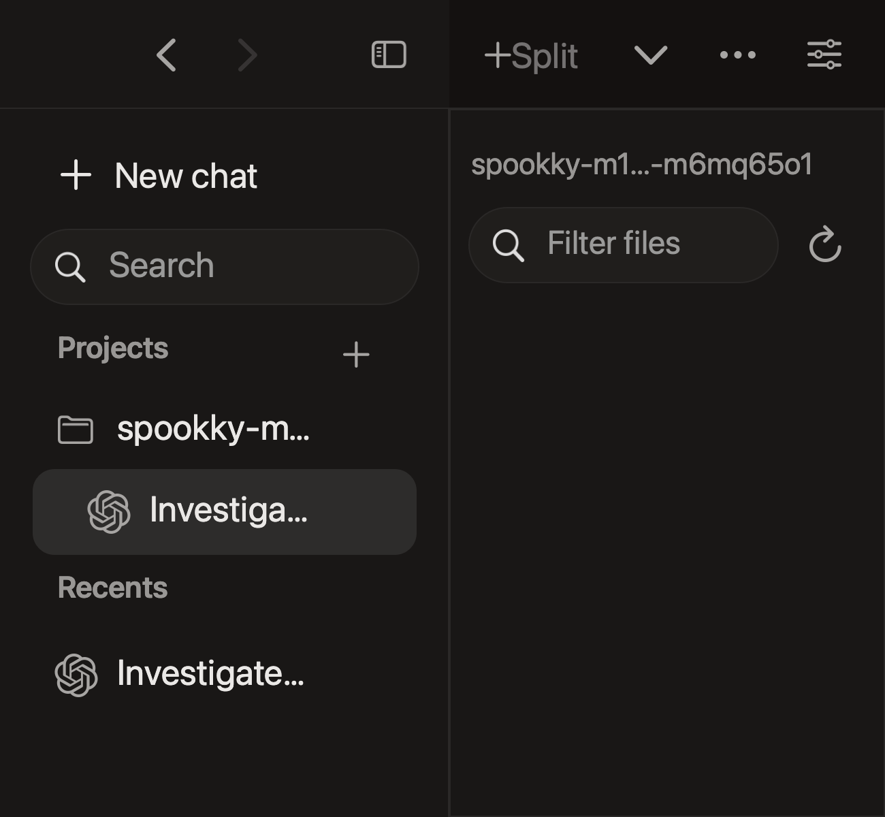
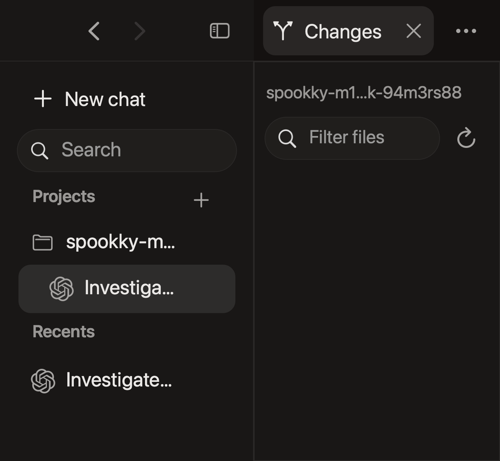

# Session audit regressions

Project registration now preserves independent drafts. Provider recovery retains exact conversation identities and never replays an initial prompt. Native header and focus regressions cover narrow windows, late terminal attachment and accessibility activation.

## Interface evidence

| Previous header | Responsive header |
| --- | --- |
|  |  |

Both captures use disposable fixture data. At 650 points and 200 percent zoom, the requested sidebar width is temporarily clamped to leave 320 points for content. The selected supporting tab remains readable. Less frequent actions move into overflow. AppKit content captures can omit native window controls. These images establish layout, not terminal visual parity.

## Finding coverage

| Finding | Result and evidence boundary |
| --- | --- |
| F01, stable identity | Both real providers acquired their exact native ID. Native and hands-on resume checks retained that ID and the original folder. |
| F02, Changes responsiveness | The existing background watch-registration repair passed the delayed-registration fixture. Stale callbacks remain rejected. |
| F03, unavailable monitoring | Thread details retains the explanation and native hook-review action. Real Codex declined broad hook trust and correctly retained unknown activity. No permission defaults changed. |
| F04, Claude initial prompt | A real initial-prompt launch completed a checklist feature task without restart or prompt replay. Delayed startup now has per-conversation recovery actions. |
| F05, text clipping | Existing file-row geometry passed the rendered accented-text, Thai, code and line-number checks at 200 percent zoom. |
| F06, narrow layout | The narrow/wide light/dark matrix passed at 80, 100, 150 and 200 percent zoom. Selected tabs remain reachable. Split still falls back to Full below its pane limits. |
| F07, Claude titles | Bounded native AI-title metadata updated the existing row and primary heading. Explicit local aliases retain precedence. |
| F08, closed terminal view | Reopen terminal retains its backing process and unsent input. Closure and termination remain separate. |
| F09, Markdown reading width | Existing semantic previews retain an 80-character reading column and local code/table scrolling. Native rendering checks passed. |
| F10, later Git initialization | In a real disposable folder, Changes switched from its non-Git explanation to an untracked file after external Git initialization. No refresh or restart was needed. |
| F11, browser state | A live form survived switching, zoom and Full/Split. Website storage and selected-file descriptors survived UI restart. Unsent web forms do not survive restart; Quit warns and Cancel retains the live form. |
| F12, ended primary | Both real CLIs exited through their native flow and resumed the same saved ID. Three repeated clicks joined one launch. Resume arguments contained no initial prompt. Codex accepted new input. Claude displayed saved output but later stalled reading native filesystem paths on its old surviving server. A later real GUI task on a fresh private runtime resumed its exact saved ID and accepted unsent Unicode. That fresh process, server, conversation and input also survived UI restart and accepted new input afterward. The old-server stall remains open. |
| F13, project drafts | Real A/B/global draft isolation passed registration, removal, navigation and restart. Removing a project retained its draft and original folder. |

Hands-on provider tasks built and extended a local checklist with no external dependencies. Embedded-browser checks exercised add, completion, filters, search, exact deletion, clear-completed and local storage. They establish these disposable workflows, not general model quality or active-agent resource budgets.

## Additional repairs found during verification

- Activity monitoring retries a missing receiver on activation or reopen. It preserves a live receiver owner. A surviving real Claude process then delivered Working and Finished unread events without changing its PID or conversation ID.
- Sidebar rows expose native accessibility Press through the same stable-identity activation path as pointer input. Section rows remain inert.
- An open sidebar menu retains its anchor while history refresh coalesces into one pending snapshot.
- Terminal reattachment preserves focus in the file picker, sidebar search and other active editors. Explicit New chat, project draft and Open Terminal actions focus their own target.
- Prepared native continuations now receive the existing activity integration after argument validation. Failure to prepare monitoring falls back to the same native command. Resume does not resolve the executable again, allocate a fresh provider ID or replay a starting prompt.
- A clean single-instance restart retained exact unsent Unicode terminal input, the process, the conversation and the selected file. Earlier mixed-build automation evidence was discarded after a stale driver binding reopened an older app copy.
- Browser downloads preserve the live form and offer an explicit external action. PDF and image previews retain native zoom behavior.

## Verification

[Native assertion results](checks.json) contain 2,667 passed assertions: 30 closure, 87 identity, 2,498 sidebar/display, 49 supporting-content and three cold-restore checks. These fixtures use synthetic provider metadata and owned real shells. They cover actual completed fullscreen transitions, tab hit areas, accessibility activation, bounded history views, live appearance recovery, selected content and input focus.

Swift reported 297 XCTest cases: 293 passed, four opt-in skips and zero failures. All 22 Swift Testing cases passed. The Python suite has 36 passed cases. Current installed CLI checks passed nine Codex cases and ten isolated Claude resume/ownership/attach cases, including unsent input through resume and attach. The Codex shared-server check used zero resume retries and retained its first-error field. The expanded Claude fixture found inherited wrapper input becoming a native prompt. Control commands now receive empty stdin; both input probes pass with one loopback model turn.

First failures remain in private local evidence. Fullscreen fixtures now wait for completed AppKit notifications. The selection fixture derives its origin from the terminal renderer. Those corrections do not turn timing retries into successful provider resumes.

## Measurements and continuity

[Matched measurements](measurements.json) used frozen baseline and candidate binaries. Resource cases ran serially in AB and BA order with five seconds of warm-up and 60 seconds of collection. Existing user agents and the real provider test sessions remained running. The foreground pairs also retained the fresh-runtime Claude session. Host load was uncontrolled.

| Measurement | Samples per build | Baseline | Candidate |
| --- | ---: | ---: | ---: |
| Empty readiness, median / p95 | 30 | 298.2 / 429.0 ms | 291.9 / 328.7 ms |
| Warm conversation selection, p95 | 35 | 25.5 ms | 25.2 ms |
| Recreated terminal selection, p95 | 105 | 60.3 ms | 59.2 ms |
| Five-shell foreground app RSS, two medians | 2 x 60 seconds | 104.1 / 127.6 MiB | 114.4 / 123.9 MiB |
| App plus owned runtime/shell RSS, same cases | 2 x 60 seconds | 114.7 / 139.6 MiB | 126.1 / 135.6 MiB |
| Foreground idle CPU, percent of one core | 2 x 60 seconds | 0.48 / 0.48% | 0.45 / 0.47% |

Both foreground pairs stayed visible and active at their CPU boundaries. Both process sets stayed stable. RSS differences changed direction across the two pairs. Separate vmmap physical-footprint observations were 128.5M / 88.6M for baseline and 87.5M / 87.7M for candidate. RSS includes shared pages and compression effects. These observations do not establish a causal memory change or performance improvement.

The separate 1/5/10-conversation matrix also completed two runs per build and count with stable process sets. Those windows were occluded and inactive at the boundaries. Their low CPU values are near collector resolution and do not replace foreground idle evidence. The JSON retains each case and its visibility boundary.

Empty readiness excludes provider discovery, the first rendered frame and CLI readiness. Selection ends at native attachment, layout and focus. It excludes first bytes and physical display latency. Both builds passed wrapped resize and crash restoration with unchanged process identities and viewport markers.

The final executable completed all 20 matched cases, including four foreground observations. The actual eight-hour background continuity workload is running with ten retained shells and repeated attachment and file updates. No eight-hour pass or performance improvement is claimed here yet.

## Remaining limits

Standalone Ghostty configuration was read, but the desktop tool denied access to its app. Visual provider-TUI parity remains unproven. Standalone Ghostty is 1.2.3; the embedded engine is 1.3.1. ANSI fixtures alone do not prove parity.

The user has no 1x display available, so physical 1x-to-2x transitions remain hardware blocked. Committed Unicode and emoji survived the real restart, but live IME composition and spoken VoiceOver remain unverified. Native accessibility and input replay are separate evidence.

The native project picker intermittently remained in a loading state during automation. Later registrations succeeded. A stock picker comparison worked. The cause is unconfirmed; a speculative deferral was reverted.

Claude resume displayed saved output but could stop accepting input on the surviving GUI-owned private server. The same native CLI also stalled there without a Spookky surface. Fresh independent private servers accepted input with the same environment and terminal settings. A read-only probe opened Claude settings but waited opening a public README in Documents on the old server. The cause remains unconfirmed. No privacy settings were changed and the server with a running Codex session was retained. A native SessionStart callback confirms that the repaired monitoring integration is connected; it does not prove input responsiveness.

Real Codex activity hooks remained gated by its native trust decision. Claude activity callbacks passed. Missing monitoring stays unknown. Native resume does not establish exclusive cross-application Claude ownership.

## Tested application source

Application source commit: `67aa7fe98010340c32dca2e9d57e259427c70499`.

Frozen Release executable SHA-256: `c886ca2916e9250e5ff153e87cb823f4fe93750d149e1ec63d1b5187663f22ca`.

Later Python collector, provider-checker and evidence commits do not change that application source. No new dependency or conversation database migration is introduced. The installed daily app is outside this verification build and has not been replaced.
