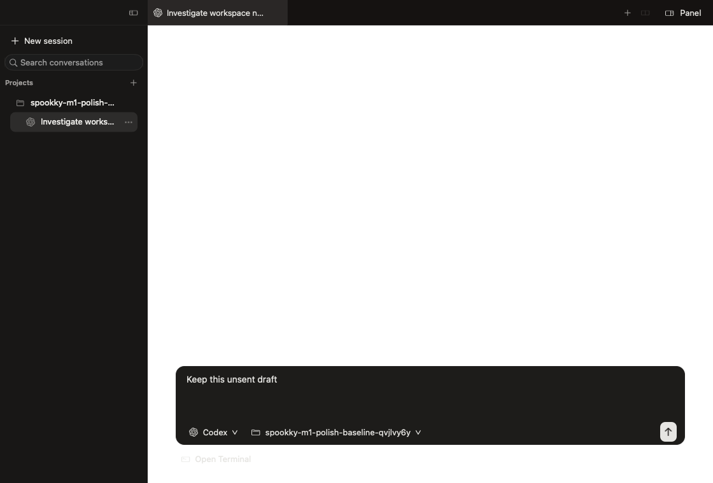

# Native interface verification

The native interface now shares display scaling, tab geometry and terminal appearance settings. The real provider terminal remains the central surface. This change does not migrate conversation metadata or replace the installed application.

## Interaction changes

- Tabs accept input across their height. Supporting tab scrolling no longer receives automatic title-bar insets or an overlay scrollbar. Only spare header space drags the window.
- Native window buttons retain their size and spacing, with a 20-point left inset and a centered position in the 40-point header at 100% zoom.
- Full and Split name the layout action. Overflow appears when tabs need it. The redundant Panel button is removed.
- Sidebar rows use one outer inset and stable title space. A six-point divider supports dragging, arrow keys and double-click reset. Requested width survives temporary window clamping.
- Working, needs-input, unread completion and failure use typed status. Unknown and acknowledged states remain quiet. Offscreen and occluded working indicators stop animating.
- Cmd+plus, Cmd+minus and Cmd+0 scale native layout and text. Browser content uses page zoom; PDF and image previews scale their content. Terminal font adjustment remains independent.
- Ghostty's pinned parser resolves normal config paths, includes and both theme variants. Only appearance settings reach Spookky surfaces. Invalid edits retain the previous valid profile. Configuration changes do not restart agents.
- Cmd+W closes a focused auxiliary window without closing the conversation behind it.

## Evidence

The images below use disposable fixture data. They are AppKit content snapshots. They exclude OS window controls and GPU terminal pixels, so they establish layout only.

| Before | After |
| --- | --- |
|  |  |

[200% zoom at narrow width](narrow-200.png) and [150% zoom in a wide light window](wide-light-150.png) show overflow and scaling. The native fixture also checks the effective appearance, tab edge/center hit targets and traffic-light coordinates.

## Checks and boundaries

The Swift suites passed 285 tests, with three optional tests skipped. Thirty Python tests, repository checks and the bundle resource audit passed. Provider-hook fixtures passed 12 cases.

Native checks cover light/dark appearance, 80%, 100%, 150% and 200% zoom, 650/1440-point windows, Split/Full layouts, configuration replacement/recovery and newly created configuration directories. History, identity, closing, grouping, browser/artifact and large-diff fixtures also passed. The large-diff workload retained 100 selection cycles. A 5,000-entry history fixture mounted two visible native cells at its measured viewport.

Manual desktop checks exercised the real Codex TUI, application zoom, Settings, top-edge tab clicks, Full/Split, native fullscreen, sidebar keyboard resizing, dragging and reset. The Codex TUI showed its configured theme colors and prompt backgrounds. Its ordinary hook-trust prompt was preserved; new hooks were not automatically trusted. Missing activity remained unknown. A separately launched Claude noninteractive turn produced working and finished events. The native Claude launch also exposed disabled private-server focus events; restoring a server now enables them without restarting its processes.

Both Codex and Claude completed a disposable READY turn through the provider workflow with visible native colors and prompt rendering. One manually shell-launched Claude process stalled before drawing, while the provider-launched instance and a separate raw PTY succeeded. That shell-startup discrepancy remains unresolved. The desktop-control tool refused standalone Ghostty inspection. Full visual parity for both providers is therefore unverified. Physical 1×/2× display transitions, spoken VoiceOver and real permission-dialog activity transitions remain unverified. Native hit testing and synthetic status events do not establish those results.

## Measurements

[Raw measurements](measurements.json) compare the previous main-based Release build with this change using four clean shell workspaces. Each resource run warms for five seconds and samples for 60 seconds. Timing uses 35 warm switches and 105 recreated-surface selections after warm-up. Existing user agents remain running.

| Metric | Previous build | Tested implementation |
| --- | ---: | ---: |
| Warm switch p95 | 21.3 ms | 30.1 ms |
| Reattachment p95 | 61.9 ms | 68.2 ms |
| App RSS median | 93.0 MiB | 73.4 MiB |
| App + private runtime/shell RSS | 101.1 MiB | 81.4 MiB |
| Idle CPU, one core | 0.48% | 0.46% |

The final run was slower on selection and used less resident memory. An earlier candidate measured 19.6/58.7 ms for those p95 timings; these single-run differences do not establish a causal improvement or regression. The fixture disables provider-history discovery and automatic user-config following. Resource results cover its native interface, terminal and private runtime workload, not all normal-app background work.

Selection timing ends at native attachment, layout and focus. It excludes first terminal bytes and physical display latency. Both runs preserve process identities and the visible history marker across crash/restore. Wrapped resize checks pass. These are single paired observations, not a statistical performance claim. The measured interface candidate predates the final focus-events option; the check file records each tested binary separately.

## Tested source

Implementation commit: `fbb1a785b58a600cedaa45971fee3b0d35cfc80a`. Release executable SHA-256: `9fa9f32e87798b83e10c237d480fa36cac122432bc1c64700f155d84533f0468`. Later evidence-only commits do not change the executable. [Check results](checks.json) retain individual assertions and binary digests.
