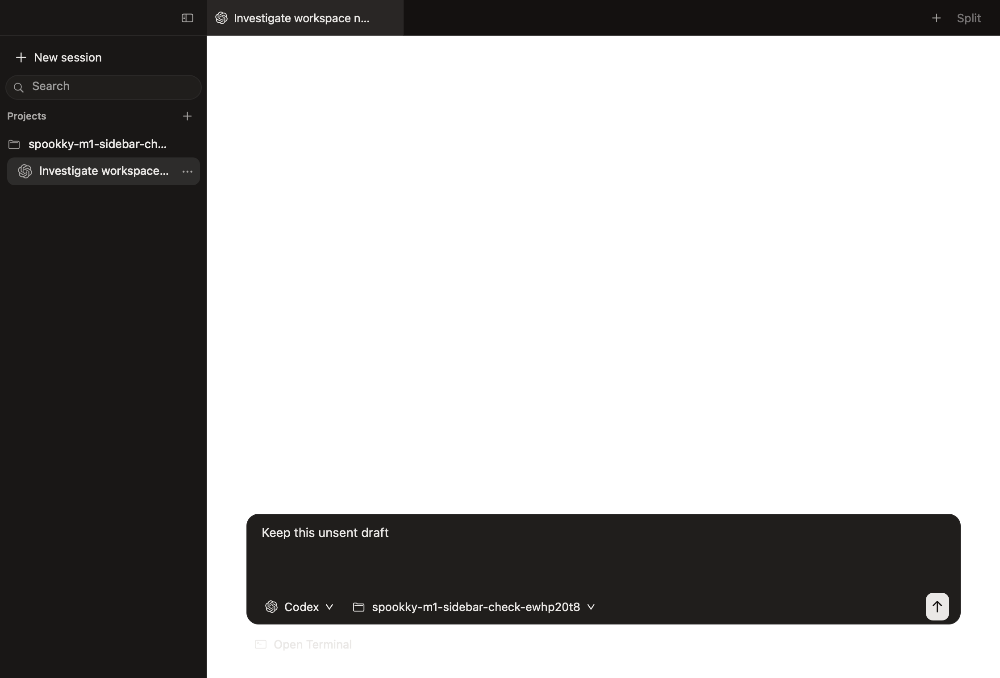
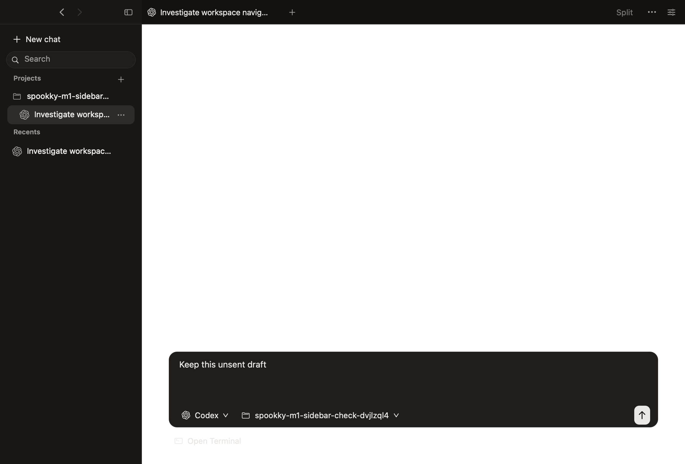
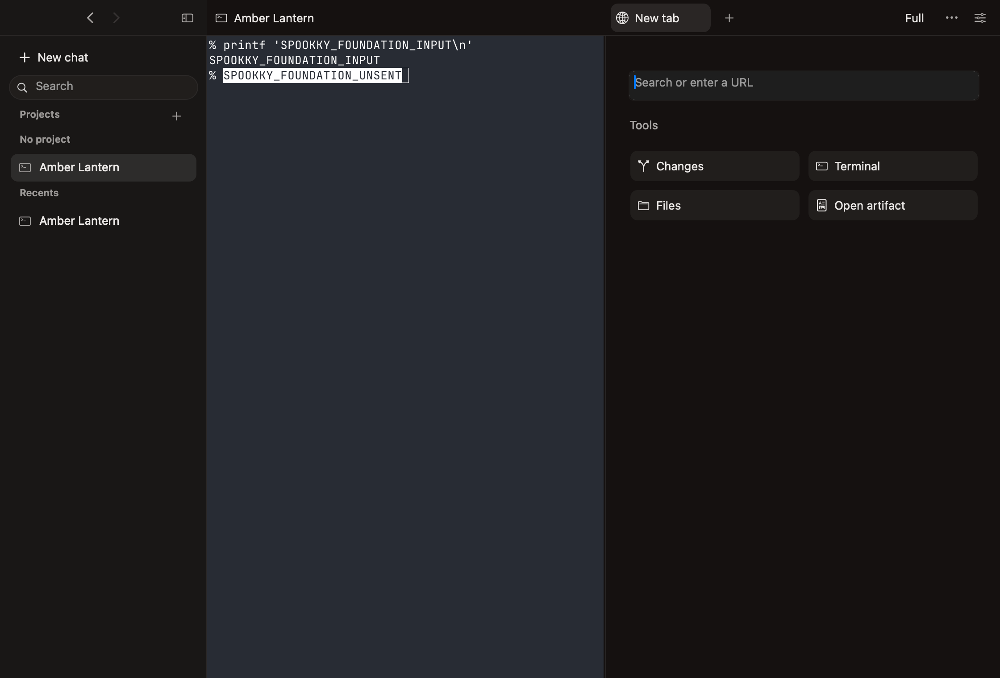

# Persistent threads and supporting tools

Conversations persist as threads. The primary heading has no close target. Supporting tools own their tabs. Project avatars and provider marks remain.

## Interface

| Previous installed build | Thread interface |
| --- | --- |
|  |  |

[Full view](full.png) joins the primary first. [Narrow 200 percent view](narrow-200.png) exercises overflow and scaling. These captures use disposable data and establish layout. AppKit content snapshots can omit native window controls. They do not establish standalone terminal parity.

## State and lifecycle

New chat selects a retained composer. Opening a support does not start an agent. Pin, archive, project assignment and back/forward navigation share stable thread identities. Cmd+W on Conversation closes its window. Supporting closure selects a neighboring support or returns to the same conversation.

Version 8 backs up and upgrades workspace metadata. Aliases, drafts, original folders, supporting descriptors, bindings and launch intents retain their identities. Local project assignment wins over provider refresh. Browser forms survive live switching; unsent forms are not guaranteed across a WebKit or app restart.

Files uses a native searchable picker. The shared search-cell correction preserves editability in history, file filters and the picker. Changes has independent selection and tracked-line totals. Markdown artifacts render read-only semantic content with JavaScript and remote resources disabled.

## Runtime correction

The first failed identity run captured a bundled tmux focus-out crash. Its null-session dereference matched the local disassembly and the call site in [upstream issue 5022](https://github.com/tmux/tmux/issues/5022). The original key parser deterministically exited with SIGSEGV in the regression probe. The guarded parser passed six focus events across detached, windowless and attached client states.

New private servers advertise the guarded focus capability. An older surviving server retains its processes and uses focus forwarding disabled. Full forwarding becomes available when a guarded server starts. The update does not stop agents to replace that server.

## Verification

The final Release passed 1,899 automated native assertions: 1,672 sidebar/display, 34 history, 87 identity/layout, 28 closure, 10 project grouping, 41 browser/artifact, three cold restore and 24 file/diff checks. Nine manual accessibility checks verified picker typing and focus, file-tab reuse, app zoom and the retained draft. Native hit-testing covered tab edges, centers and close targets in both appearances at 80%, 100%, 150% and 200%.

Swift passed 294 of 297 cases, with three opt-in cases skipped. All 30 Python tests passed. Release build and bundle runtime/resource verification passed. The file fixture completed 100 selection cycles; its 30 measured selections had a 110.3 ms p95. Syntax readiness had a 177.0 ms p95. These native fixtures use synthetic provider metadata and disposable real shells.

[Individual checks](checks.json) retain the tested binary identifiers. The first failures were retained before corrections. One fixture still expected schema 7. The browser fixture still expected Cmd+T to materialize a browser immediately. The file fixture still expected tracked totals to be hidden. Those assertions now follow the current contract.

Standalone Ghostty control was blocked by the desktop tool. Full provider visual parity, physical display transitions, IME composition and spoken VoiceOver remain unverified. The real provider TUI remains in Ghostty. No replacement chat renderer or transcript store is introduced.

## Measurements

| Measurement | Samples per build | Previous installed code | Thread revision |
| --- | ---: | ---: | ---: |
| Empty process readiness, median / p95 | 10 | 277.4 / 1170.1 ms | 292.5 / 1606.8 ms |
| Warm thread selection, p95 | 35 | 17.7 ms | 27.7 ms |
| Recreated terminal selection, p95 | 105 | 62.8 ms | 58.8 ms |
| Four-shell app RSS, median | 265 / 264 | 133.3 MiB | 122.0 MiB |
| App plus owned runtime/shell RSS, median | 265 / 264 | 151.5 MiB | 132.7 MiB |
| App physical footprint observation | 1 | 81.3M | 85.5M |
| Idle CPU, percent of one core | 60 seconds | 0.45% | 0.50% |

Performance is mixed. Warm switching and startup were slower; RSS was lower and physical footprint was higher. Ten startup samples do not establish a stable tail-latency estimate. The slow first samples remain included. Both resource windows followed five seconds of warm-up and retained four processes and one visible terminal surface. The windows were visible and active at both CPU boundaries. Both crash/restore and wrapped-resize checks passed without extra workspaces or processes.

[Paired measurements](measurements.json) retain both binary identifiers. The baseline copy has the installed code from `0d147b3` plus its recorded local simplification diff. Only its bundle identity and signatures changed for fixture isolation.

These are single paired observations with four clean shell threads. Existing user agents stayed running. Selection ends at native attachment, layout and focus. It excludes first bytes and physical display latency. The workload disables provider discovery and automatic user-config following.

## Tested source

The tested code commit is `7ec529ce52f28290c0374195de79c62452a84ded`. The unstripped tested Release executable SHA-256 is `9ad800cb0611ee5132d63a1c58a6e9a6f6ca5ff6a5178c7e0096191379d4400c`. Later documentation commits do not change its source. Local packaging compares the executable text sections of the app and all three helpers with this tested bundle.
