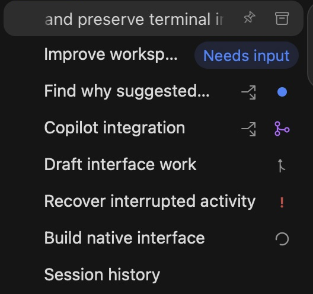
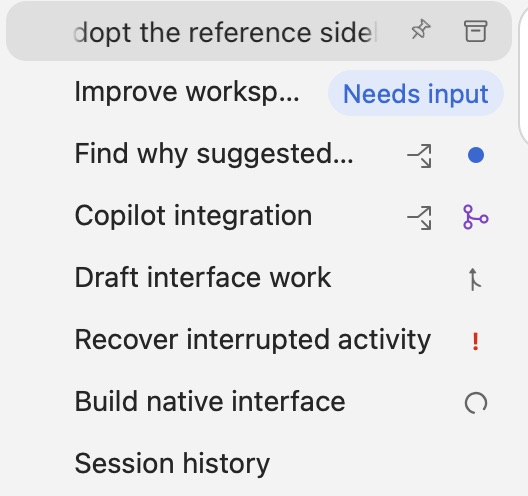
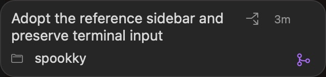
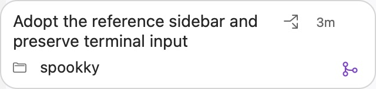

# Sidebar reference verification

The sidebar uses the supplied geometry and status treatment in an isolated development build. Verification ran on 19 and 20 October 2026. The branch is `codex/sidebar-reference-parity`, based on `origin/main` at `0729e811b5b10d50b6c7597f511d2fbe38d1a202`.

## Appearance and interaction

The default sidebar is 264 points wide. Saved widths remain unchanged. Conversation rows are 31 points high, with a 30-point highlight, 3/8-point horizontal insets and 10-point corners. Titles start at 35 points and use regular 14-point text. Projects use outlined folders. Conversation rows have no provider logo.

The status position shows an 8-point blue unread dot, 10-point gray working ring, or 23-point blue Needs input pill. Activity takes precedence over PR status. The separate worktree glyph requires Git verification. Hover and keyboard focus reveal Pin/Unpin and Archive/Unarchive through the existing thread actions.

Overflowing titles move after 500 ms at 30 points per second, pause for 800 ms, then restart. Short titles stay still. Reduce Motion stops both title movement and ring rotation. A non-activating card exposes the full title, project, relative activity time and PR information. Opening PR information opens its URL.

The native matrix covered dark/light, 1120/650-point windows and 100%/150% zoom. It checked geometry, hover actions, screen-clamped cards, unchanged selection, keyboard focus, motion, Reduce Motion, row reuse and 5,000-row virtualization. Native window captures covered all eight variants. These crops retain two pixels per point at 100% zoom. They exclude window controls and the macOS capture overlay.

| Dark | Light |
| --- | --- |
|  |  |
|  |  |

The supplied images define appearance. Direct inspection of the reference app was unavailable. Motion timing uses the explicitly approved defaults.

## Check results

- The native reference matrix passed 109 assertions. The sidebar/display regression passed 1,845 assertions. Five native restart checks passed.
- Swift completed 297 XCTest cases with four skipped and zero failures. Another 22 Swift Testing cases passed.
- All 32 Python tests and 12 packaged-helper hook cases passed.
- The Release build, bundle runtime/resource audit and strict development signature verification passed.

The verified native binary has SHA-256 `8ee450e9dcb73f17b257f4cb05882c9640642d35f00ed686460b2d8b45f16efe`.

## Resource observations

| Observation | Idle | Hover |
| --- | --- | --- |
| App CPU, percent of one core | 0.13 | 0.07 |
| Active observation, seconds | 5.21 | 5.20 |
| Mounted rows | 9 | 9 |
| Animated titles | 0 | 1 |
| Pending hover-delay tasks | 0 | 0 |

Both phases included a visible working ring. The 5,000-row case retained 11 native row views. CPU covers only the app process. It excludes WindowServer, GPU and provider costs. The short samples do not establish a performance difference between idle and hover.

The terminal fixture observed one private pane, four runtime/shell processes and no app-owned Git or `gh` subprocess at readiness. The app used 172.9 MiB resident memory; runtime and shells used 17.2 MiB. Their summed resident memory was 190.1 MiB. Shared pages prevent interpreting this sum as unique physical memory. No real provider processes were present in that sample. Sidebar refresh uses one 60-second timer while active. Title and ring movement use Core Animation rather than per-frame timers. Lookup tests observed a peak of two concurrent requests and a cache no larger than 128 entries.

## Status and unread behavior

The read-only GitHub service uses the installed `gh` executable and existing authentication. It rejects ambiguous matches and fork collisions. A closed or merged PR must match the observed checkout commit before association. Imported history receives no badge from its directory alone. Verified associations survive metadata reload; fetched states remain transient.

Focused tests cover activity precedence, branch reuse, stale completion receipts, unknown viewport state, backward-compatible metadata, request deduplication, cancellation, a 128-entry cache and a two-request concurrency bound. Disposable Git repositories verify main-checkout and linked-worktree detection. An opt-in installed-CLI check read the verified merged status of public PR #16.

The native terminal fixture confirmed unread completion in scrollback, acknowledgment after returning to the bottom, background completion and visible split panes. Viewing a terminal retained Needs input and failure. It also confirmed real shell input, unsent input, stable process identity, pin/archive identity and focus behavior. A separate native restart retained the same unseen completion and three original shell processes. Lost tracking became Unknown. Core tests cover a newer completion arriving during acknowledgment.

## Real provider flows

| Provider | Question | Denial | Approval and resumption | Completion |
| --- | --- | --- | --- | --- |
| Codex CLI 0.163.0 | Native CLI question answered | Interrupted; disposable file remained absent | Approved once; disposable file contained `OK` | Working and Finished hooks observed |
| Claude Code 2.1.303 | Native CLI question answered | Disposable file remained absent | Approved once; CLI reported successful Bash completion | Working and Finished hooks observed |

Both question flows emitted Needs input, Working and Finished. Codex used normal hook trust in a private configuration with on-request approvals and a read-only sandbox. Claude used its default permission mode. No permission bypass flags were added. The initial unattended Codex smoke did not pass its hook-trust gate; the interactive private fixture completed that normal trust flow. Twelve existing hermetic hook cases also passed.

The Claude fixture expired before a separate filesystem readback of its approved command. Its success is supported by the CLI result and callbacks. Codex has the additional filesystem readback. Provider flows were observed through real launch-helper callbacks in disposable terminals. They were separate from the native sidebar's synthetic activity fixtures.

## Reproduce

Run the commands in [development](../../development.md#sidebar-attention-checks). Local reports live under ignored `.cache/` state. `check_sidebar_reference.py --external-captures` pauses each variant for an external native screenshot. It publishes `capture-ready.json` in the printed private root and continues after a `captured-VARIANT` marker. Save screenshots as `reference-native-VARIANT.png` in that root. The checker copies them into its output image directory.

AppKit bitmap captures of the layer-backed main window were blank on this host. Those files are excluded from evidence. The published crops come from native window screenshots through the computer-use driver. Hover-card bitmap captures are supplemental.

These checks do not establish provider-internal scroll position, physical pointer or trackpad behavior, spoken VoiceOver, notification delivery, overnight continuity or older macOS compatibility. Completion means the provider ended a turn. It does not assert task success. Production replacement, publishing and pushing are outside this pass.
